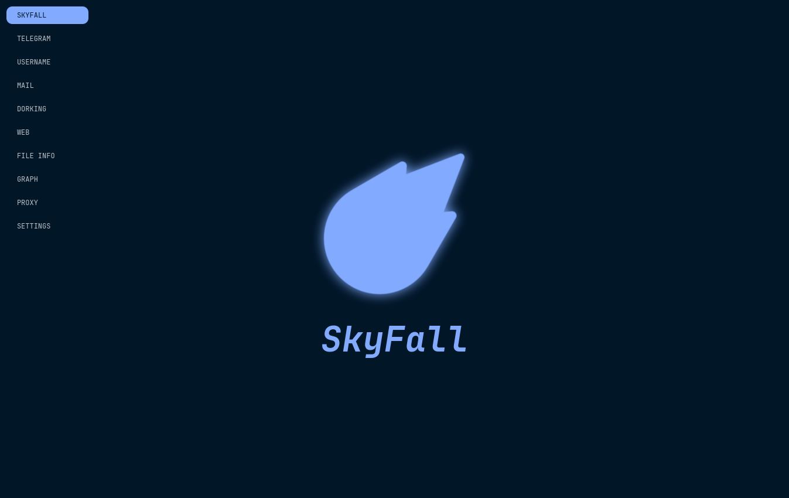

<div align="center">

# `SkyFall Project`

<br /><br />


<br /><br /><br /><br />



<br /><br />

**Desktop OSINT investigation toolkit** — Python 3 + PySide6 (Qt 6).

Domain, Telegram, username, email, Reddit, phone, MAC, social, leaks, geo,
archive, blockchain, file and image analysis wired into an interactive
relationship graph and an AI report generator (local Ollama), plus an MCP
server so agents can drive the tools.

<br />

[Full feature documentation](./DOC.md) · [License (MIT)](./LICENSE) · [Issues](https://github.com/Nighty3098/SkyFall/issues)

<br /><br />

</div>

## `FEATURES`

| Module | What it does |
|---|---|
| **Web / Domain** | 16-step domain recon: IP + geolocation, DNS, WHOIS, SSL/TLS, headers + WAF, robots.txt, security.txt, cookies, social tags, subdomains (passive + brute), Certificate Transparency, ports (NMAP), threat intel (AbuseIPDB/GreyNoise/ThreatFox/URLHaus), reputation aggregator (VirusTotal/Google Safe Browsing/CRDF/AbuseIPDB/GreyNoise/ThreatFox/URLHaus), JS secrets scan, domains on IP (PTR/Shodan InternetDB/HackerTarget) |
| **Telegram** | Channel/group collection via MTProto into SQLite (posts, members, links, media, avatars) + analyzer that builds a relationship graph and exports GraphML/GEXF/JSON/CSV/PNG/HTML/Obsidian |
| **Username** | Maigret (~510 sites) + a Sherlock-style engine (~481 sites) with WAF detection; links confirmed by both engines are flagged ✅ at the top, single-engine hits are grouped by source |
| **Mail** | IntelX search, Have I Been Pwned, `.eml`/header analyzer (SPF/DKIM/DMARC, Received chain, IP geolocation, verdict), and registered-accounts discovery (Gravatar/Microsoft/Mozilla/ProtonMail/Duolingo/Twitter + a `holehe` sweep of ~120 sites) |
| **Social** | Username lookup on open networks — Bluesky (AT Protocol), Mastodon (ActivityPub) and Instagram (`instaloader`); profile, bio, followers/posts, plus handle matches |
| **Reddit** | Archival profile OSINT from Arctic Shift + PullPush queried concurrently (no keys): posts/comments merged by id and classified live/removed/deleted, activity histograms + timezone estimate, PII exposure score, top subreddits and technologies, extracted identifiers; optional OAuth live profile |
| **Leaks** | Leak & infostealer search by email/username/domain: Hudson Rock infostealer logs (no key), LeakCheck, Have I Been Pwned, Dehashed |
| **Geo** | Sun/shadow geometry and inverse shadow geolocation (local `suncalc`), NASA FIRMS active fires, GDACS disaster alerts |
| **Archive** | Wayback Machine (closest snapshot, CDX listing, on-demand save) and archive.today checks |
| **GitHub** | User, repo, commit, email and secret scanning (~240 patterns) over the REST API with multi-token rotation |
| **Phone** | Parse/validate (phonenumbers), reverse lookup (NumVerify/AbstractAPI), leaks (IntelX), reviews (7tel.ru) |
| **MAC** | BSSID geolocation via Yandex/Apple/Google/Microsoft/Mylnikov with a map |
| **Blockchain** | Find transactions by indirect data (time, amount, memo) across Tron, TON, Ethereum, BSC, Base, Solana, BTC, LTC, DOGE, BCH |
| **Steganography** | LSB counts + chi-square, FFT spectral analysis, end-of-file payloads, tail-data detection, ELA heatmap |
| **Files** | Metadata + hashes, printable strings, VirusTotal, GPS map, and metadata cleaning (many formats) |
| **Search4Faces** | Reverse face search (VK photos) |
| **Dorking** | ~7,900 Google dorks in 14 categories via DuckDuckGo or a local SearXNG |
| **Graph** | 13 entity types, 12 relation types, drag-and-drop palette, transforms that enrich nodes via the modules above (incl. Reddit OSINT, merged username, leaks, archive, geo), shortest path / centrality / community detection, JSON + image export |
| **AI Report** | 7-section structured OSINT report from every panel via local Ollama, with `[FACT]/[INFERRED]/[HYPOTHESIS]` markers |
| **MCP** | 89 tools over stdio/SSE so AI agents can drive the modules; optional bearer-token auth and a token-protected graph bridge on `127.0.0.1:9878` |
| **Cases** | Investigation workspace with automatic per-module Markdown autosave |

> Detailed per-tab reference, settings and API keys: [`DOC.md`](./DOC.md).

## `REQUIREMENTS`

- **Python 3.13+** (CI targets 3.14)
- **PySide6 / Qt 6** and a working display (X11 or Wayland)
- **NMAP** installed system-wide (for the port-scan step)
- **Docker** (optional) — for a local SearXNG instance used by Dorking
- **Telegram API ID/Hash + phone** — only for the Telegram modules
- Optional API keys (VirusTotal, IntelX, HIBP, GitHub, Etherscan, LeakCheck, Dehashed, NASA FIRMS, …) — see [`DOC.md`](./DOC.md)

## `SETUP SEARXNG`

To work with dorking, you need to run searxng via docker:

```bash

docker compose up --build

```

## `DOWNLOAD`

```bash

git clone https://github.com/Nighty3098/SkyFall --recurse-submodules

```

## `INSTALL (Linux)`

System-wide install like wifite2 — copies the app to `/opt/skyfall`,
creates the `skyfall` launcher, the app-menu entry and icons
(X11 + Wayland):

```bash

sudo python3 setup.py

# run it
skyfall

# update after git pull (just re-run)
git pull
sudo python3 setup.py

# uninstall
sudo python3 setup.py uninstall

```

Without root (installs to `~/.local`):

```bash

python3 setup.py --user

```

## `RUN (without install)`

```bash

python3 -m venv venv
source venv/bin/activate
pip3 install -r requirements.txt

python3 main.py

# debug mode (verbose logs)
python3 main.py -d

```

## `TELEGRAM SESSION`

Before using the Telegram downloader/analyzer, authorize a Telethon session
(`tg_session.session`):

```bash

python3 setup_telegram.py

```

## `CONNECT MCP TO OPENCODE`

The project ships an MCP server exposing the OSINT tools. To use it from [opencode](https://opencode.ai):

1. **Start the server** — either run the GUI and click `Start MCP Server` in `SETTINGS`, or launch it standalone:

```bash
python3 src/skyfall_mcp_server.py --transport sse --host 127.0.0.1 --port 9877
```

2. **Configure opencode** — add the following to `opencode.json` in your project root (an identical config is already provided):

```json
{
  "$schema": "https://opencode.ai/config.json",
  "mcp": {
    "skyfall": {
      "type": "remote",
      "url": "http://127.0.0.1:9877/sse",
      "enabled": true
    }
  }
}
```

3. Restart opencode and verify the server appears in `/mcp`.

### Optional: secure the MCP server with a bearer token

The MCP server binds to `127.0.0.1`, but any local process could still call its tools. Enable `Require MCP Auth` in `SETTINGS` (or run the standalone server with `SKYFALL_MCP_REQUIRE_AUTH=1`). A token is generated at `~/.skyfall/mcp_token` and must then be sent by clients. In `opencode.json`:

```json
{
  "$schema": "https://opencode.ai/config.json",
  "mcp": {
    "skyfall": {
      "type": "remote",
      "url": "http://127.0.0.1:9877/sse",
      "enabled": true,
      "headers": { "Authorization": "Bearer <contents of ~/.skyfall/mcp_token>" }
    }
  }
}
```

The same token also protects the graph bridge on `127.0.0.1:9878`, which the MCP server uses to read and modify the graph in a running GUI.

## `SECURITY`

- **Secrets at rest** — API keys and tokens are encrypted (Fernet) inside `~/.skyfall/settings.json`; the encryption key lives in `~/.skyfall/secret.key` (`0600`). Existing plaintext files are migrated automatically the next time you press **Save** in `SETTINGS`.
- **Local access token** — `~/.skyfall/mcp_token` (`0600`) secures the MCP server (`Require MCP Auth`) and the graph bridge.
- **Bindings** — the MCP server (`127.0.0.1:9877`) and graph bridge (`127.0.0.1:9878`) listen on loopback only.

> The encryption key is stored next to the data, so at-rest encryption protects
> against backups, screenshots and accidental sharing — not against software
> running as your OS user. Use a full-disk/OS keyring if you need more.

## `DATA & STORAGE`

- **`~/.skyfall/`** — `settings.json` (encrypted secrets), `secret.key`, `mcp_token`, `proxies.txt`, `logs/`, `data/`.
- **Cases** — folder per investigation with `domains/`, `telegram/`, `username/`, `email/`, `social/`, `leaks/`, `geo/`, `archive/`, `github/`, `phone/`, `mac/`, `blockchain/`, `files/`, `steganography/`, `reports/`, `dorking/`, `downloads/`, `graph/`.
- **Telegram DB** — SQLite `SkyFall_TG.db` (`channels`, `users`, `posts`, `discussions`, `members`, `links`) and `SkyFall_TG_media/`.

## `DEVELOPMENT`

```bash

# Lint check
./check.sh

# Auto-format
./format.sh

```

The pipeline is `main.py → src/connectors.py (Qt signals) → src/controllers/ → src/modules/`.
See [`DOC.md`](./DOC.md) for the full code map.

## `CONTACTS`

Main Developer: https://t.me/Night3098

GitHub: https://github.com/Nighty3098

## `THIRDPARTY`

### TXFetch — Blockchain Transaction Search Engine

Blockchain transaction retrieval tool — find a transaction hash using only indirect data: time, amount, and network.

- **Author:** xaynov (https://github.com/xaynov-osint)
- **License:** [MIT](./thirdparty/txfetch/LICENSE)
- **Repository:** https://github.com/xaynov-osint/txfetch
- **Copyright:** Copyright (c) 2026 xaynov

## `GENERATE THIRD-PARTY NOTICES`

```bash

pip install pip-licenses
pip-licenses --with-authors --with-urls --format=markdown > THIRD_PARTY_NOTICES.md

```
